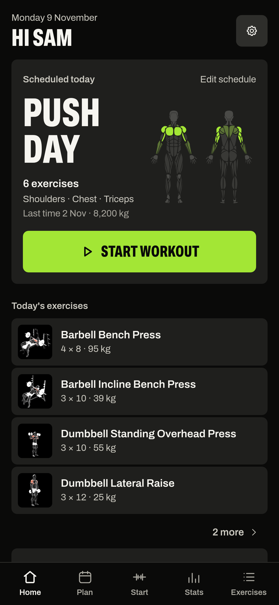
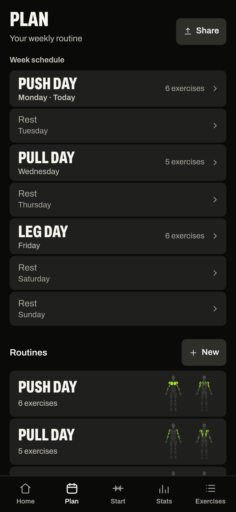
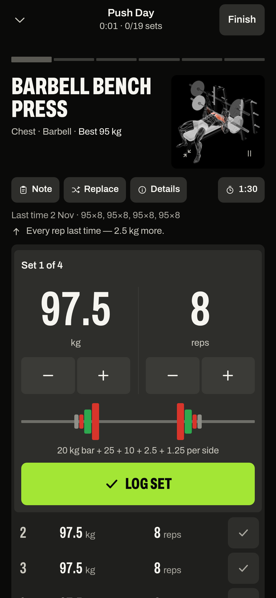
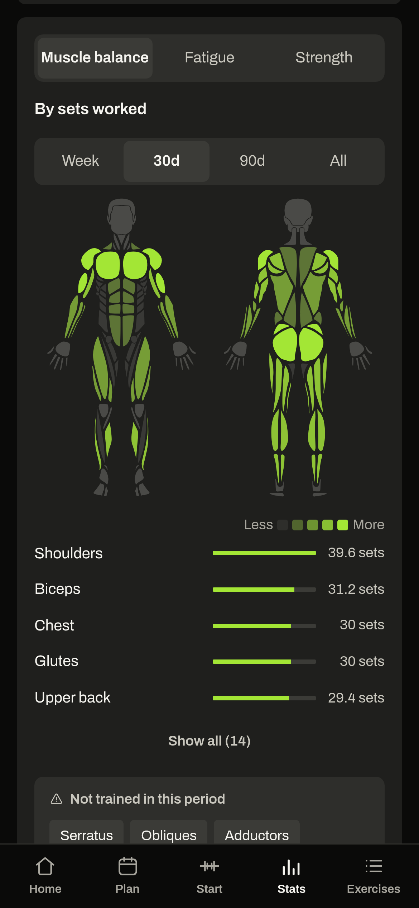
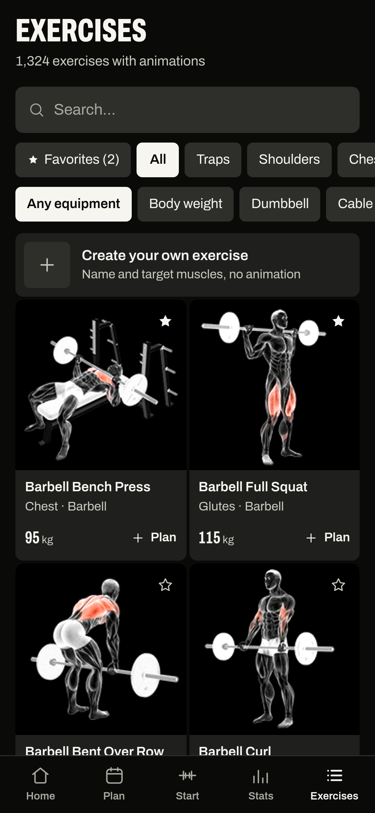

<div align="center">

# Sky

**A gym and body-weight tracker for one person. No account, no server.**

Plan your training week, log workouts one set at a time, and see what your log says about
progress, fatigue and strength. Everything stays on your device.

**[Open Sky at skyfitness.pages.dev](https://skyfitness.pages.dev)**

<br>

[](LICENSE)


</div>

<br>

<div align="center">
<table>
<tr>
<td align="center"><br><sub><b>Home</b><br>Today's routine</sub></td>
<td align="center"><br><sub><b>Plan</b><br>Week schedule</sub></td>
<td align="center"><br><sub><b>Workout</b><br>One set at a time</sub></td>
<td align="center"><br><sub><b>Stats</b><br>Muscle maps</sub></td>
<td align="center"><br><sub><b>Exercises</b><br>1,324 with animations</sub></td>
</tr>
</table>
<sub>Screenshots use a seeded demo profile, not a real training log.</sub>
</div>

## What Sky is

Sky is a static web app. There is no sign-up, no login, no backend and no cloud sync. Your
routines, workouts and weigh-ins are stored in the browser on the device you use.

The default build sends no analytics. Apart from loading the app itself, the only network
requests are for exercise images and animations from a public CDN, and each one is cached once
you have seen it.

Every target Sky gives you is worked out from what you logged, and it tells you why: "Every rep
last time — 2.5 kg more."

## Features

### Plan

- **Week schedule.** Give each day a routine or a rest day.
- **Rescheduled days.** Swap one day's routine, or make it a rest day, without changing the
  week schedule.
- **Routines.** Pick exercises, sets, reps and a progression rule for each one.
- **Starter plan.** Push / Pull / Legs, three days a week, if you want somewhere to start.
- **Exercise catalogue.** 1,324 exercises with animations. Search by name, filter by muscle or
  equipment, and keep favourites.
- **Your own exercises.** Add a name and the muscles it trains.

### Train

- **One set at a time.** Weight and reps in large figures with step keys, and one Log set key.
  The other sets fold to one line each.
- **Plates drawn for you.** Barbell lifts show the plates per side, and say it in words:
  "20 kg bar + 25 + 10 + 2.5 + 1.25 per side". A load that no plates can make is stated, not
  rounded.
- **Targets filled in.** Weight and reps come from your last workout and your progression rule.
- **Rest timer** with sound, docked above the Log set key.
- **Focus mode.** A running workout takes the whole screen. The chevron minimises it.
- **Keep screen awake** while a workout runs, where the browser supports it.
- **Every kind of set.** Weight and reps, bodyweight, timed holds, and cardio (minutes and
  speed).
- **Supersets.** Pair two exercises to do them back to back.
- **Warm-up sets.** Marked as warm-ups, so they never count towards progression or fatigue.
- **Change the plan mid-workout.** Add, replace and reorder exercises, and add notes.
- **Freestyle workouts.** Start without a routine and pick exercises as you go.
- **Effort per set (optional).** Rate a set in RIR (reps in reserve) or RPE. Nothing else reads
  the rating: progression and estimated 1RM are unaffected.

### Progression rules

Each exercise in a routine can follow one of these rules. When you miss too often, the rule backs
off the load. If the load is already as low as it goes, Sky holds the target instead.

| Rule | How it moves |
| --- | --- |
| **Linear** | Hit every rep in every set and the weight goes up. Three misses in a row bring a deload. |
| **Greyskull LP** | Two straight sets, then a last set taken to failure. Beat the target on that set and the weight goes up, twice as much if you double the reps. One failure resets the weight by 10 %. |
| **Double progression** | Work up a rep range at the same weight. Reach the top of the range in every set and the weight goes up, with reps back to the bottom. |
| **Add time** | For timed holds: hold the target and the next one is longer. |
| **Bodyweight** | Add reps after each clean workout. At the top of the rep range, add a set and start the reps again from the bottom. |

### Stats

- **Muscle maps**, front and back, across 19 muscle groups:
  - **Muscle balance:** sets per muscle over a week, 30 days, 90 days or all time, and which
    muscles went untrained.
  - **Fatigue:** how recently each muscle was trained, fading with a 36-hour half-life.
  - **Strength:** retained strength, fading with a 28-day half-life since you last trained the
    muscle. Tap a muscle to see its exercises.
- **Exercise progress.** A curve per exercise: estimated 1RM, best set weight, longest hold, top
  speed or average effort per workout.
- **Estimated 1RM** by the Epley formula, and only for sets of 12 reps or fewer.
- **Records.** A new best load or estimated 1RM is marked when you finish a workout, and the
  monthly recap lists them.
- **History.** Every workout, a calendar, activity over the last 12 months and a monthly recap.
- **Effort.** Where your working sets land, week by week.

### Body weight

- **Weigh-ins** with a chart and your change over 30 days. Sky asks once a day, before your
  first workout.
- **Goal weight** drawn as a line on the chart.

### Settings

- Dark theme (the default) or light theme, and five accent colours: lime, sky, violet, pink
  and teal. Text meets WCAG AA contrast in both themes under every accent, and the test suite
  checks it.
- A male or female body for the muscle maps.
- kg or lb. Switching changes the label only; logged numbers are not converted.
- Rest length, sounds, and a reminder on days that have a routine planned.
- An optional display name for the greeting on Home.

Sky also has a desktop layout, with a labelled sidebar and two-column screens.

## Your data

### Where it lives

- Sky writes to `localStorage` and mirrors to `IndexedDB`. At start-up it keeps whichever copy is
  newer.
- The native iOS and Android apps also mirror to a file in the app's private storage.
- Nothing is sent to a server, because there is no server.

### Backup and restore

- **Export backup** saves your whole profile as `sky-backup-<date>.json`.
- **Import backup** restores that file.
- Settings reminds you when you have gone 14 days without a backup.

### Import from other apps

- **FitNotes** (Android and iOS CSV exports)
- **Strong** (CSV export)
- **Hevy** (CSV export)
- **Apple Health** (body weight from `export.xml`)

Imports merge into your profile and match exercise names to the catalogue. Days you already have
win, so importing the same file twice never duplicates a workout.

### Share a plan

- **Plan file.** Send your routines to a friend. The file holds routines only: no workouts,
  weigh-ins or settings.
- **Print or save as PDF.** A clean printout of your plan. No exercise is split across two pages.

## Offline

Once Sky has loaded, it works without a connection. The service worker caches the app, and every
screen is fetched in the background after the first one appears, so you can start a workout at a
gym with no signal.

## Install

### On your phone

**iPhone (Safari):** open [skyfitness.pages.dev](https://skyfitness.pages.dev), tap **Share**, then
**Add to Home Screen**.

**Android (Chrome):** open [skyfitness.pages.dev](https://skyfitness.pages.dev), tap **⋮**, then
**Install app** or **Add to Home screen**.

### As a native app

`frontend/ios` and `frontend/android` are Capacitor shells around the same interface. Build them
with:

```bash
cd frontend
npm run build:mobile
```

Then open the project with `npx cap open ios` or `npx cap open android`. See
[docs/MOBILE.md](docs/MOBILE.md) for prerequisites, signing and running on a device.

## Run it locally

You need [Node.js](https://nodejs.org/) 20.19 or newer, or 22.12 or newer. CI uses Node 22.

```bash
cd frontend
npm install
npm run dev
```

Open the URL it prints (by default `http://localhost:5173`).

## Build for hosting

```bash
cd frontend
npm run build
```

The static files go to `frontend/dist/`. Upload them to any static host. The live app is on
Cloudflare Pages: `frontend/public/_headers` sets its security and cache headers.
[docs/SELF_HOSTING.md](docs/SELF_HOSTING.md) has guides
for other hosts.

## Exercise media

Exercise images and animations come from a pinned commit of the exercise dataset on jsDelivr.
They are not in this repository.

To host them yourself, download the ~140 MB media package into `frontend/public/media/`:

```bash
cd frontend
npm run media:fetch
```

## Tests

```bash
cd frontend
npm test                     # Vitest suite
npm run test:fatigue-probe   # property check: fatigue never rises across a rest day
npm run test:preview         # Playwright smoke test of the built app (run npm run build first)
```

CI runs the Vitest suite, the build and the fatigue probe on every pull request and on pushes
to `main`.

## Project layout

```
frontend/              React 19 + Vite app; builds to static files
  src/views/           one file per screen
  src/lib/             training logic (progression, 1RM, recovery, imports) with tests beside it
  src/store/           the Zustand store that holds all app state
  ios/, android/       Capacitor shells for the native apps
docs/                  architecture, ADRs, hosting and mobile guides
landing/               the landing page
scripts/               dataset and media tools
```

## Documentation

- [GLOSSARY.md](GLOSSARY.md): what words like workout, entry, set and target mean in Sky
- [docs/architecture.md](docs/architecture.md): the data model, storage and the algorithms
- [docs/adr/](docs/adr/): decisions and why they were made
- [DESIGN.md](DESIGN.md): the visual system
- [CONTRIBUTING.md](CONTRIBUTING.md), [SECURITY.md](SECURITY.md), [CHANGELOG.md](CHANGELOG.md)

## License and third-party notices

- **Source code:** Sky's own code is under the [MIT License](LICENSE).
- **Exercise dataset:** MIT License, from `hasaneyldrm/exercises-dataset`, derived from ExerciseDB.
- **Body diagram geometry:** MIT License, from Melih Colpan's MuscleMap.
- **Exercise media:** images and animations are third-party content (© Gym visual).

Full notices are in [NOTICE.md](NOTICE.md).
